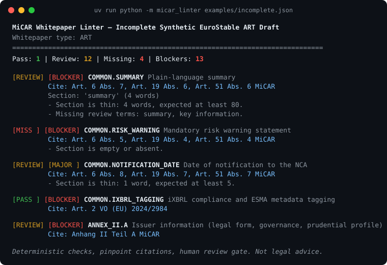

# MiCAR Whitepaper Linter

[](https://github.com/sebastianfoerste/micar-whitepaper-linter/actions/workflows/ci.yml)
[](LICENSE)
[](pyproject.toml)

**Flag missing and thin disclosures in draft MiCAR white papers before substantive legal review, using deterministic Annex I, II and III checks with pinpoint citations.**

<!--
  Screenshot/GIF placeholder — to be added.
  Replace the note below with a screenshot or GIF of a real run (for example `make demo`
  in a terminal, or a GitHub Action job log), stored under docs/ with descriptive alt text.
-->
> **Screenshot/GIF placeholder — to be added**

## Who it's for

- **Lawyers and compliance teams** reviewing a MiCAR white paper draft who want a cited first-pass list of candidate disclosure gaps before the substantive legal review.
- **Teams drafting a white paper in a Git repository** who want every push checked in CI.

Rule sets cover all three white paper regimes under MiCAR (Regulation (EU) 2023/1114): crypto-assets other than ARTs and EMTs (Annex I), asset-referenced tokens (Annex II) and e-money tokens (Annex III). It is a screening tool, not a sign-off: whether a white paper is lawful or complete remains a lawyer's judgment. Not legal advice.

## Try it now

- **GitHub Action:** add `sebastianfoerste/micar-whitepaper-linter@v1` to a workflow in the repository that holds your draft. Findings and their citations appear in the job log, and by default (`strict: 'true'`) the job fails while BLOCKER-severity findings are open. See [Use as a GitHub Action](#use-as-a-github-action) for the snippet and inputs, or start from the [micar-whitepaper-template](https://github.com/sebastianfoerste/micar-whitepaper-template) repo, which ships the workflow preconfigured.
- **Local CLI:** follow the [Quick start](#quick-start) below. The core linter runs locally and does not require external LLM or network processing.

## Quick start

Requires Python 3.13+, uv and make. From a clone of this repository:

```bash
make install   # uv sync --extra dev
make demo      # lint examples/incomplete.json, a synthetic ART draft with open blockers
uv run micar-lint examples/incomplete.json --review-bundle-dir /tmp/micar-incomplete-review-bundle
```

The last command also writes a review bundle to `/tmp/micar-incomplete-review-bundle`: compliance and remediation checklists, a coverage matrix, a review table, a reviewer sign-off record and an artifact manifest.

To check your own draft, pass its path to `uv run micar-lint` instead of an example file:

- A JSON draft states its regime in its `type` field. For an XHTML or DOCX draft, add `--type other|art|emt`; the numbered-field XHTML layout requires it.
- `--strict` exits with status 1 while any BLOCKER finding is open.
- `--json` prints machine-readable JSON instead of text.

## Browser workbench (local preview)

The repository includes a browser workbench in `docs/playground/`. The full linter runs client-side via Pyodide. Nothing you paste leaves the page.

The browser workbench accepts JSON drafts up to 1 MB and XHTML white papers up to 4 MB, includes synthetic examples for all three regimes, and presents searchable findings with citations and section navigation. Download the current report as JSON or text, or save a copy of the draft. Editing a checked draft marks the previous results as stale and disables report export until the checks run again. Python runs in a web worker so the editor stays responsive.

For local preview, run `python3 -m http.server 8765 --bind 127.0.0.1 --directory docs` and open `http://127.0.0.1:8765/playground/`. The first runtime load needs an internet connection. The app does not persist drafts in browser storage.



## Real-world study: MiCAR Title II white papers

This repository now includes a reproducible pilot study over publicly available Title II crypto-asset white papers listed in ESMA's MiCA register.

The study runs deterministic Annex I checks over a reproducible convenience sample and publishes machine-flagged candidate gaps, exact document hashes, extraction metadata, limitations, and a 150-cell human-review matrix. The candidate flags are not reviewed legal findings.

Read the study report and validation protocol:

- `studies/2026-07-title-ii-annex-i-whitepaper-study/findings-summary.md`
- `studies/2026-07-title-ii-annex-i-whitepaper-study/review-protocol.md`
- `studies/2026-07-title-ii-annex-i-whitepaper-study/human-review-matrix.csv`

Raw white papers are not committed. Study outputs are deterministic first-pass research artifacts and are not legal advice.

## Run it

Installation, the demo and a review bundle are covered in the [Quick start](#quick-start). Run the test suite with:

```bash
make test
```

Check an XHTML white paper in the numbered-field layout of Implementing Regulation (EU) 2024/2984 ("A.1 Name", "A.2 Legal form"). State the regime, because it is not inferred from the text of such a file:

```bash
uv run micar-lint examples/numbered-other-draft.xhtml --type other
```

The Table 2 mapping (crypto-assets other than ARTs and EMTs) has been run against public register documents. The Table 3 and Table 4 mappings follow the Official Journal text and have not yet been run against a real ART or EMT white paper. The iXBRL check tests well-formedness, the Inline XBRL 1.1 namespace and the ESMA MiCA taxonomy namespace. It does not evaluate the taxonomy's existence and value assertions, so it never reports Pass.

## Use as a GitHub Action

Lint a whitepaper draft on every push. The job fails while BLOCKER-severity findings are open:

```yaml
jobs:
  micar-lint:
    runs-on: ubuntu-latest
    steps:
      - uses: actions/checkout@v4
      - uses: sebastianfoerste/micar-whitepaper-linter@v1
        with:
          whitepaper: drafts/whitepaper.json
          strict: 'true'
```

Inputs: `whitepaper` (path to a JSON/XHTML/DOCX draft), `strict` (default `true`), `extra-args` (e.g. `--json`, `--coverage`). A failing job means open blockers to review, not a legal conclusion.

Fastest start: the [micar-whitepaper-template](https://github.com/sebastianfoerste/micar-whitepaper-template) repo ships this workflow preconfigured — click **Use this template**.

The canonical template source now lives at `templates/whitepaper-starter` in this repository. The existing public template repository remains the release surface. Run `make template-check` to validate its JSON and workflow contract, then `make template-export` to prepare a local path-export branch for human review. The export command never pushes.

## Reviewer Route

For a short proof review, follow this path:

1. Read `docs/launch-readiness.md`.
2. Read `docs/sample-review-bundle.md`.
3. Read `studies/2026-07-title-ii-annex-i-whitepaper-study/findings-summary.md`.
4. Inspect `src/micar_linter/rules/`.
5. Run `make check`.

This route keeps the human-review boundary visible while showing the deterministic rules, synthetic examples, and 2026 study methodology.

## Core features

- Deterministic regulatory audits for MiCAR Annex I, II and III.
- JSON, XHTML and DOCX parsing.
- Rules-as-code severity engine.
- JSON reports for automated checks.
- Local artifact manifests and remediation reports.
- Coverage matrices, review tables and batch packs.
- Review table export: adds rule-by-rule rows with blocker status, citations, remediation, reviewer decision state and bundle export eligibility.
- Workspace export: `--workspace-output <path>` writes a local batch vault, conditional review table and reusable review playbook. Open blockers keep filing and external-review readiness disabled.

## Verified behavior

MiCAR white-paper requirements can be encoded as deterministic, cited and testable rules. Annex selection is explicit, rule IDs are stable, unmatched disclosure patterns produce cited candidate flags, severity is tested, and JSON outputs can be used by review workflows without hiding the legal basis.

The tool preserves legal judgment. It flags candidate disclosure gaps and produces draft review artifacts. It does not decide whether a white paper is lawful or complete.

The reserve-floor check extracts percentage candidates and identifies the potentially applicable threshold under Articles 35(4), 36(4)(d), 45(3) and 45(7)(b) MiCAR from draft characterisation fields. It never returns `PASS`: applicability and any legal conclusion remain subject to lawyer confirmation.

## Tech stack

Python, Hatchling, uv and pytest.

## Verification checklist

- Run `make check`.
- Run `uv run micar-lint examples/art-stablecoin.json`.
- Run `uv run micar-lint examples/incomplete.json`.
- Generate a review bundle from a synthetic example.
- Confirm fixture labels are synthetic.
- Confirm report output states that the tool is not legal advice.

## Collaborative redline bundle

Run `micar-lint <draft> --workspace-output workspace.json --collaboration-bundle-dir review/` to generate a digest-bound collaboration sidecar, MiCAR playbook change set and supervised workflow pack. Accepted changes can be rendered as genuine OOXML tracked insertions and deletions in a copied DOCX. The source draft is never overwritten.

## Related

Part of a portfolio of deterministic, review-gated EU-regulation tools:

- [eu-ai-act-classifier](https://github.com/sebastianfoerste/eu-ai-act-classifier) — EU AI Act risk-tier classifier with cited obligations and a browser playground.
- [dpa-and-data-transfer-review](https://github.com/sebastianfoerste/dpa-and-data-transfer-review) — GDPR Art. 28 and Chapter V transfer checks with a visible review state.
- [micar-whitepaper-template](https://github.com/sebastianfoerste/micar-whitepaper-template) — Starter repo that lints a whitepaper draft in CI using this tool.

Curated index of EU financial-regulation primary sources and tools: [awesome-eu-fintech-regulation](https://github.com/sebastianfoerste/awesome-eu-fintech-regulation).
