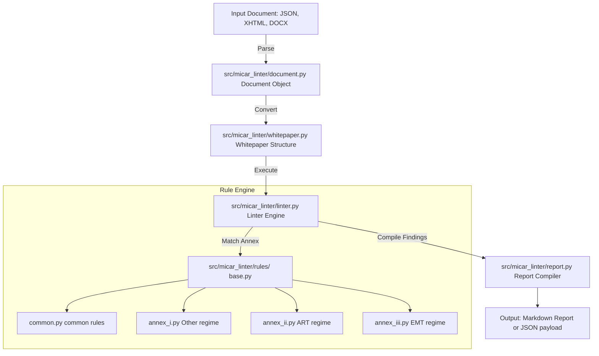

# System Architecture: MiCAR Whitepaper Linter

This document explains the internal modules, parsing pipeline, and rules-as-code structure of the MiCAR Whitepaper Linter.

## System Pipeline

The linter acts as a deterministic parser and check engine:

---

## Technical Components

### 1. Document Parsing Layer
Normalizes inputs into structural sections:
- **`document.py`**: Base document model tracking raw text, headings, and tables.
- **`xhtml_parser.py`** & **`ixbrl.py`**: Parse Inline XBRL XHTML files, extracting tagged compliance attributes.

### 2. Regulatory Regimes (`rules/`)
Each rule is a `Rule` record from `rules/base.py` (section, keywords, minimum length, severity, citation):
- **`common.py`**: Checks for disclosures required in every white paper (summary, risk warning, management-body statement, notification date, language, iXBRL format).
- **`annex_i.py`**: Specific to Other Crypto-Assets.
- **`annex_ii.py`**: Specific to Asset-Referenced Tokens (checks for reserve-of-assets and redemption disclosures).
- **`annex_iii.py`**: Specific to E-Money Tokens (checks for issuer licensing and redemption disclosures).

### 3. Report Compiler (`report.py`)
Collects and groups rule findings, prioritizing open blockers (items to cure before notification or submission for approval) over other findings.