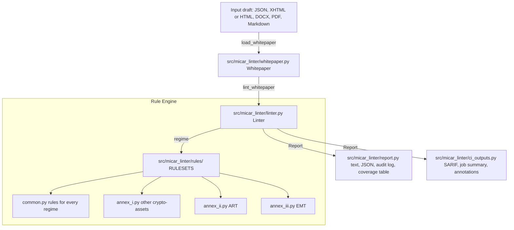

# System Architecture: MiCAR Whitepaper Linter

This document explains the internal modules, loading pipeline, and rules-as-code structure of the MiCAR Whitepaper Linter. `AGENTS.md` has a fuller module map and lists the places a change commonly has to reach.

## System Pipeline

The linter is a deterministic loader and check engine:

---

## Technical Components

### 1. Loading Layer
`load_whitepaper` in `whitepaper.py` picks a loader by file suffix and returns a `Whitepaper`: a title, a regime, a map of section keys to text, and metadata that rule logic reads (for JSON, every other top-level key except the reserved ones, with `ixbrl_validated` forced to false; for the other formats, the source file, the iXBRL results, any extraction notes and `script_packed_source`, which is true only for a saved iXBRL viewer page).
- **JSON**: read directly. The draft states its regime in its `type` field (`other` when the field is absent), and `--type` is ignored for it. The other formats take the regime from `--type` (single-file runs only) or, without it, from marker phrases: in the whole text for PDF and DOCX, in the text of the recognised sections for XHTML, HTML and Markdown.
- **`document.py`**: PDF, DOCX and Markdown section extraction, and the heading-to-section matching (`SECTION_PATTERNS`) that every heading-based loader uses. The table cells of a DOCX draft are not read; PDF and Markdown table text is read as ordinary lines. A first-page statement without a heading of its own is routed by its wording to `not_approved_statement` (`opens_statement`, which also reads an opening that wraps onto the next lines, and `statement_extent`), here and in the heading-based XHTML loader. The statement takes whole lines or paragraphs, so text after it in its last line or paragraph stays with it. An ART draft keeps no such section.
- **`xhtml_parser.py`**: XHTML and HTML text and heading-based sections. It reads text only from the elements its selection picks (see `xhtml_parser.py`), so text elsewhere, such as a bare table cell, can go unread. It also recognises a saved iXBRL viewer page, which carries the white paper packed in a script, and unpacks it (at most 8 MB); the loaders then read the unpacked markup, `ixbrl.py` does not run on it, and `COMMON.IXBRL_TAGGING` stays missing. A page that cannot be unpacked is refused with a message: a single-file run exits 1, and the directory batch skips the file with a `lint-failed:` warning. **`numbered_fields.py`** reads the numbered-field layout of Implementing Regulation (EU) 2024/2984, whole table cells included; its regime must be given with `--type`.
- **`ixbrl.py`**: format checks for Inline XBRL (the iXBRL 1.1 namespace and facts tagged with the ESMA MiCA taxonomy). It does not check tag completeness.

### 2. Rules (`rules/`)
Each rule is an instance of the frozen `Rule` dataclass in `rules/base.py`: a stable rule ID, a citation, a section key (the one the generic checks read), a label, a severity (BLOCKER, MAJOR or MINOR), and its listed terms, patterns and minimum length. `RULESETS` in `rules/__init__.py` combines:
- **`common.py`**: the rules every regime runs: summary, risk warning, management statement, notification date, language, the iXBRL format check and two LEI checks. Other crypto-assets and ARTs take them as `COMMON_RULES`; e-money tokens take `EMT_COMMON_RULES`, the same rules except that `COMMON.RISK_WARNING`, under the same ID, checks the two warnings of Art. 51(4) MiCAR.
- **`annex_i.py`**: crypto-assets other than asset-referenced tokens and e-money tokens (Annex I).
- **`annex_ii.py`**: asset-referenced tokens (Annex II), including the reserve of assets.
- **`annex_iii.py`**: e-money tokens (Annex III), and a review prompt on the funds received. An electronic money institution safeguards them under Art. 7(1) EMD2 (applied by Art. 48(3) MiCAR), and funds so safeguarded are deposited and invested under Art. 54 MiCAR; no Annex III item asks the white paper to describe them.
- **`terms.py`**: the named patterns that stand for terms a plain substring would also find inside other words, such as "fee" in "feedback". A report names the pattern's group among the missing terms.

`Linter` in `linter.py` applies the generic checks to most rules. A section that is empty or holds only placeholder text is missing; otherwise listed terms, required and prohibited patterns and a minimum word count decide between review and pass. Six rules have their own logic, dispatched by rule ID: the iXBRL format check and the ART deposit-floor review, which never pass, the two LEI checks, and the notification-date and language checks, which pass when the section names a calendar date or an official EU language, however short it is. The two first-page statement rules send a German statement or a yes/no field answer to review and otherwise run the generic checks, which for the Title II statement rule also add a rule-specific issue when no "offeror", "person seeking admission to trading" or "operator of the trading platform" stands directly before "of the crypto-asset is solely responsible", as where the statement names the issuer (`_rule_specific_issues` in `linter.py`). A second person named before them, or words added around the two sentences, are not detected.

### 3. Outputs
`lint_whitepaper` returns a `Report` of findings, each with a status: pass, review or missing. `report.py` renders it as text, JSON, a Markdown audit log or a coverage table, and each of these counts the open BLOCKER findings. While any finding is open, BLOCKER or not, the text report says the draft is not package-ready and should not enter an external review or filing workflow until BLOCKER items are cured and a lawyer has signed off; the audit log gives that warning only while a BLOCKER finding is open. `tests/test_report.py` pins that wording. `ci_outputs.py` renders SARIF, a job summary and workflow annotations that carry no draft text. Other modules build the review table, review bundle, remediation report, coverage matrix and artifact manifest; `cli.py` writes the outputs to the paths given.

A pass means a check matched. It is not a compliance opinion.
