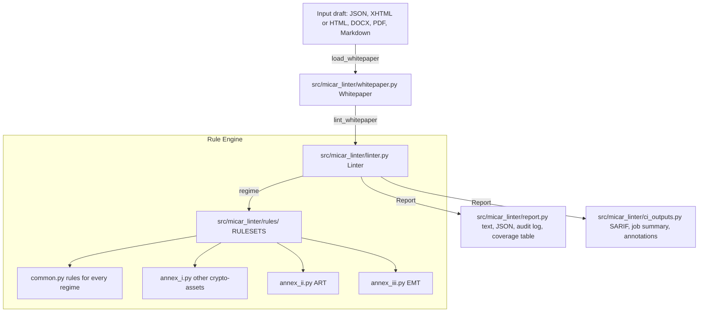

# System Architecture: MiCAR Whitepaper Linter

This document explains the internal modules, loading pipeline, and rules-as-code structure of the MiCAR Whitepaper Linter. `AGENTS.md` has a fuller module map and lists the places a change commonly has to reach.

## System Pipeline

The linter is a deterministic loader and check engine:

---

## Technical Components

### 1. Loading Layer
`load_whitepaper` in `whitepaper.py` picks a loader by file suffix and returns a `Whitepaper`: a title, a regime, a map of section keys to text, and metadata that rule logic reads (for JSON, every other top-level key except the reserved ones, with `ixbrl_validated` forced to false; for the other formats, the source file, the iXBRL results, any extraction notes, `script_packed_source`, which is true only for a saved iXBRL viewer page, and `placeholder_fields`, the fields of each section that hold only a placeholder in a numbered-field draft; a numbered-field draft also carries `numbered_fields`, the answer of every field by its number).
- **JSON**: read directly. The draft states its regime in its `type` field (`other` when the field is absent), and `--type` is ignored for it. The other formats take the regime from `--type` (single-file runs only) or, without it, from marker phrases: in the whole extracted text for PDF, in the text of the body's paragraphs for DOCX (python-docx's paragraph text: the runs and hyperlinks that stand directly in a paragraph, headings and runs marked hidden included, so not its tables, text boxes, headers or footers, nor text inside a tracked insertion, move or deletion, a content control, a smart tag, a simple field or custom XML), in the text of the recognised sections for XHTML, HTML and Markdown. A marker that a negation governs in its clause does not count; a pseudo-negation such as "not limited to" or "without limitation" governs no list item after it where every negation word of its lead-in stands in one, so not after "The token does not qualify as any of the following, including but not limited to:" (`_negated` and `_continued` in `whitepaper.py`; `_regime_pieces` there splits the text into the pieces whose clauses it reads, and `docs/SETUP.md` states the rules).
- **`document.py`**: PDF, DOCX and Markdown section extraction, and the heading-to-section matching (`SECTION_PATTERNS`) that every heading-based loader uses. The table cells of a DOCX draft are not read into sections, nor is text that a body paragraph holds other than as the text of its own runs and hyperlinks (in a tracked insertion, move or deletion, a content control, a smart tag, a simple field, custom XML or a text box); PDF and Markdown table text is read as ordinary lines. Apart from the sections, the DOCX and PDF loaders keep their headings, which regime inference reads with the extracted text, and the whole text of the file (`DocumentSections.document_text`: for a PDF every extracted line, text drawn invisibly included; for a DOCX the paragraphs of the body, its tables and text boxes, and the headers and footers, runs marked hidden, text moved away under tracked changes and any `w:t` inside a tracked deletion included) and, where it differs, the same text without what a reader cannot see (`DocumentSections.shown_text`: for a DOCX without tracked deletions, moved-away text and runs hidden, under 1 pt high or wide, or white with no highlight or run or cell shading behind them, by the run's own properties, its styles, its table's style and the document defaults, joined as Word shows it, see `_DocxLook`; for a PDF without text drawn in render mode 3 or 7, in white, with glyphs under 1 pt high or wide, or in optional content that the default configuration turns off, see `_PdfInk` and `_OptionalContent`; hidden text that still takes up its room on the page, a DOCX run laid out white or under 1 pt and all hidden PDF text, leaves a zero-width space where it stood, and where this reading fails for any reason it is dropped, so the file is read as without it), and the Markdown loader keeps the file as written. Only `COMMON.LEI_CHECK_DIGITS` reads these texts, each as written and as a renderer shows it (ADR 0007). `load_whitepaper` keeps the whole text under the reserved metadata key `document_text`, followed, a blank line apart, by the text of each section that the draft's regime drops, so that rule checks a code there as in a section the regime keeps, except that a valid code there never counts as found; the text without what a reader cannot see, where a loader keeps one, goes under `shown_text` and covers those sections too. That rule reads a code that a PDF table cell wraps onto the next line as one only where one of the two lines names an LEI label, so in a party table whose LEI label stands only in its header row the two pieces are not paired (ADR 0007). A first-page statement without a heading of its own is routed by its wording to `not_approved_statement` (`opens_statement`, which also reads an opening that wraps onto the next lines, and `statement_extent`), here and in the heading-based XHTML loader. The statement takes whole lines or paragraphs, so text after it in its last line or paragraph stays with it. An ART draft keeps no such section.
- **`xhtml_parser.py`**: XHTML and HTML text and heading-based sections. It reads section text only from the elements its selection picks (see `xhtml_parser.py`), so text elsewhere, such as a bare table cell, can go unread there; `document_text` reads every text that lxml's HTML parser keeps outside the head, scripts, styles and templates for `COMMON.LEI_CHECK_DIGITS` (ADR 0007): the parser drops CDATA sections and leaves an entity that a document declares in its own DTD unexpanded, so neither is read, and text that CSS or the `hidden` attribute hides (`display:none`, `visibility:hidden`) is read as if shown. `document_texts` reads that text and, from the same parse in a second walk, the text as a browser shows it by the document's own markup (`_shown_flow`: each element's `style` attribute, read as CSS reads it, the `hidden` attribute, the elements and fallback content a browser does not render, a closed `
` or `<dialog>`, SVG elements that are not rendered; no style sheets), which that rule reads besides it. It joins text nodes across inline elements in time linear in the length of the text, also where a run of spans makes one long word, and so does `text_fragments`, which the section loader and `numbered_fields.py` use, except where a word broken after its hyphen waits at a ` ` for its rest: each ` ` after such a word searches the whole line joined so far again, and joining the rest of the word copies the line, so the time grows with the square of the line's length on a run of words that each break after a hyphen at a ` ` (`x- ` repeated) and on one long word that ends in a hyphen before many ` ` elements (both new since 1.2.1, which reads both shapes in linear time because it runs the text on across a ` ` and so has no word broken there to join; the CHANGELOG gives measured times). It also recognises a saved iXBRL viewer page, which carries the white paper packed in a script, and unpacks it (at most 8 MB); the loaders then read the unpacked markup, `ixbrl.py` does not run on it, and `COMMON.IXBRL_TAGGING` stays missing. A page that cannot be unpacked is refused with a message: a single-file run exits 1, and the directory batch skips the file with a `lint-failed:` warning. **`numbered_fields.py`** reads the numbered-field layout of Implementing Regulation (EU) 2024/2984, whole table cells included; its regime must be given with `--type`.
- **`ixbrl.py`**: format checks for Inline XBRL (the iXBRL 1.1 namespace and facts tagged with the ESMA MiCA taxonomy). It does not check tag completeness.

### 2. Rules (`rules/`)
Each rule is an instance of the frozen `Rule` dataclass in `rules/base.py`: a stable rule ID, a citation, a section key (the one the generic checks read), a label, a severity (BLOCKER, MAJOR or MINOR), and its listed terms, patterns and minimum length. `RULESETS` in `rules/__init__.py` combines:
- **`common.py`**: the rules every regime runs: summary, risk warning, management statement, notification date, language, the iXBRL format check and two LEI checks. Other crypto-assets and ARTs take them as `COMMON_RULES`; e-money tokens take `EMT_COMMON_RULES`, the same rules except that `COMMON.RISK_WARNING`, under the same ID, checks the two warnings of Art. 51(4) MiCAR.
- **`annex_i.py`**: crypto-assets other than asset-referenced tokens and e-money tokens (Annex I).
- **`annex_ii.py`**: asset-referenced tokens (Annex II), including the reserve of assets.
- **`annex_iii.py`**: e-money tokens (Annex III), and a review prompt on the funds received. An electronic money institution safeguards them under Art. 7(1) EMD2 (applied by Art. 48(3) MiCAR), and funds so safeguarded are deposited and invested under Art. 54 MiCAR; no Annex III item asks the white paper to describe them.
- **`terms.py`**: no rules of its own, so not part of `RULESETS`: the named patterns that `common.py` and the three annex modules import for terms a plain substring would also find inside other words, such as "fee" in "feedback". A report names the pattern's group among the missing terms.

`Linter` in `linter.py` applies the generic checks to most rules. A section that is empty or holds only placeholder text is missing; otherwise listed terms, required and prohibited patterns and a minimum word count decide between review and pass, and in a numbered-field draft a field of the section that holds only a placeholder sends the rule to review. `COMMON.SUMMARY` counts its 80 words without the predefined warning of the template: field 07 of Table 2 (I.04 of Table 3, I.05 of Table 4) in a numbered-field draft, and the warning's English or German sentences in any draft. Eight rules have their own logic, dispatched by rule ID: the iXBRL format check and the ART deposit-floor review, which never pass for a loaded draft, the two LEI checks, the notification-date and language checks, which pass, however short the section is, when it names an existing date with day, month and a year from 1900 to 2099, written as in 2026-03-02, 02.03.2026 or 2/3/2026 or with the month in English or German (2 March 2026, 2. März 2026), or names an official EU language by its German name or by its English name as written or in capitals ("English", "ENGLISH", not "english"), and the two point rules for the contact details of Annex I and III Part A point 6 (ADR 0005). Those read the template fields that carry the point in a numbered-field draft, A.8 to A.10 of Table 2 or A.9 to A.11 of Table 4, each for its own item, and search the `offeror` or `issuer` section for a telephone number, an e-mail address and a period in days in any other draft (`contact.py`). The two first-page statement rules send a German statement or a yes/no field answer to review and otherwise run the generic checks, which for the Title II statement rule also add a rule-specific issue when no "offeror", "person seeking admission to trading" or "operator of the trading platform" stands directly before "of the crypto-asset is solely responsible", as where the statement names the issuer (`_rule_specific_issues` in `linter.py`). A second person named before them, or words added around the two sentences, are not detected.

`ANNEX_II.I` runs the generic checks and also adds a rule-specific issue when the redemption section mentions par value (`_mentions_par_value` in `linter.py`). Art. 49(4) MiCAR sets redemption at par value for e-money tokens; under Art. 39(2) an ART issuer pays funds equivalent to the market value of the referenced assets or delivers those assets. The check reads the words alone and leaves it to the reviewer what the par value refers to.

### 3. Outputs
`lint_whitepaper` returns a `Report` of findings, each with a status: pass, review or missing. `report.py` renders it as text, JSON, a Markdown audit log or a coverage table, and each of these counts the open BLOCKER findings. While any finding is open, BLOCKER or not, the text report says the draft is not package-ready and should not enter an external review or filing workflow until BLOCKER items are cured and a lawyer has signed off; the audit log gives that warning only while a BLOCKER finding is open. `tests/test_report.py` pins that wording. `ci_outputs.py` renders SARIF, a job summary and workflow annotations that carry no draft text. Other modules build the review table, review bundle, remediation report, coverage matrix and artifact manifest; `cli.py` writes the outputs to the paths given.

A pass means a check matched. It is not a compliance opinion.
